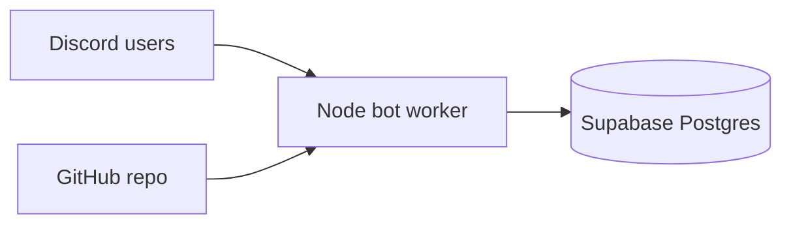

# ByteBits — Discord virtual casino

Premium **play-money** casino bot for Discord: provably fair outcomes, published paytables (~95% RTP on even-chance games), four games, Supabase economy, 24/7 worker deploy.

> **Not real money.** Credits are virtual. No deposits, cashouts, or redemption. See [docs/FAIRNESS_AND_CURRENCY.md](docs/FAIRNESS_AND_CURRENCY.md).

## Architecture



## Quick start

1. [Discord Developer Portal](https://discord.com/developers/applications) — bot token, `applications.commands` scope.
2. Supabase — run migrations in order:
   - [supabase/migrations/001_bytebets_core.sql](supabase/migrations/001_bytebets_core.sql)
   - [supabase/migrations/002_fairness_and_nonce.sql](supabase/migrations/002_fairness_and_nonce.sql)
3. Copy `.env.example` → `.env` and fill Discord + Supabase vars.
4. `npm install && npm run register-commands && npm run dev`

## Commands (P0)

| Command | Description |
|---------|-------------|
| `/help` | Lobby overview |
| `/balance` | Credits, wagered, PNL |
| `/daily` | +500 credits / 24h |
| `/leaderboard` | Wagered or profit |
| `/fairness` | Server seed hash + your client seed / nonce |
| `/seed` | Set client seed |
| `/paytable` | Published v1 odds |
| `/verify` | Replay-verify a bet with revealed server seed |
| `/coinflip` | ~1.90× on win |
| `/dice` | ~5.70× on win |
| `/roulette` | European wheel |
| `/mines start` | Interactive 5×5 grid |
| `/ping` | Health |

## Development

```bash
npm run typecheck
npm run check:migrations
npm test
```

Engineering phases and acceptance criteria: [CURSOR_MASTER_PROMPT.md](CURSOR_MASTER_PROMPT.md).

## Deploy (Render)

Use [render.yaml](render.yaml): build runs `npm install && npm run register-commands`, start `npm start`.

## Roadmap

- **P1** — Full lobby UX, VIP cosmetics, challenges, admin tools  
- **P3** — Discord Activity (slots, animated roulette)  
- **P4** — Reference crypto prices, server layout scripts  

See [docs/ROADMAP.md](docs/ROADMAP.md) and [docs/PRODUCT_SPEC.md](docs/PRODUCT_SPEC.md).
