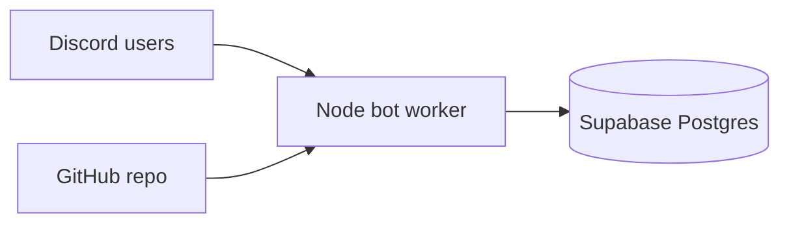

# ByteBets — Discord community bot

Play-money casino-style community bot for Discord: **balances**, **wagered**, **PNL**, **leaderboards**, and starter games (`/coinflip`, `/dice`). Data lives in **Supabase**; the bot runs 24/7 on a cloud **worker** (Render/Railway), deployed from **GitHub**.

> **Not real money.** Credits are virtual. Real crypto payouts and licensed slots need legal/licensing work — see [docs/ROADMAP.md](docs/ROADMAP.md).

## Architecture



- **Discord** — slash commands only; no website required to play.
- **Supabase** — source of truth for players, bets, leaderboards.
- **GitHub** — push code; host pulls and redeploys.
- **Render** (recommended) — `render.yaml` defines a background worker (Discord needs a long-lived connection; serverless/Vercel alone is a poor fit).

## 1. Discord application

Same as before: [Developer Portal](https://discord.com/developers/applications) → create app → **Bot** token → invite with `bot` + `applications.commands`.

Save:

- `DISCORD_TOKEN`
- `DISCORD_CLIENT_ID`
- `DISCORD_GUILD_ID` (your test server — commands update instantly)

## 2. Supabase database

1. Create a free project at [supabase.com](https://supabase.com).
2. **SQL Editor** → paste and run [supabase/migrations/001_bytebets_core.sql](supabase/migrations/001_bytebets_core.sql).
3. **Project Settings → API**:
   - `SUPABASE_URL` = Project URL
   - `SUPABASE_SERVICE_ROLE_KEY` = **service_role** (secret — bot server only, never in frontend code)

## 3. Local test (optional)

```bash
npm install
cp .env.example .env
# fill in Discord + Supabase vars
npm run register-commands
npm run dev
```

Try `/daily`, `/coinflip`, `/leaderboard`.

## 4. Deploy with GitHub + Render

1. Push this repo to **GitHub** (or connect the repo Cursor created).
2. [Render](https://render.com) → **New → Blueprint** (or **Background Worker**):
   - Connect the GitHub repo
   - Runtime: Node
   - **Build command:** `npm install && npm run register-commands`
   - **Start command:** `npm start`
3. Add environment variables in Render (same as `.env`):
   - `DISCORD_TOKEN`, `DISCORD_CLIENT_ID`, `DISCORD_GUILD_ID`
   - `SUPABASE_URL`, `SUPABASE_SERVICE_ROLE_KEY`
4. Deploy. Logs should show `Logged in as YourBot#…`.

Alternatively use **Railway** or **Fly.io** with the same env vars and `npm start`.

### Why not “just Supabase”?

Supabase is the **database**, not the Discord connection. The bot process must stay online to receive Discord events. Supabase Edge Functions do not replace a Discord gateway worker.

## Commands

| Command | Description |
|---------|-------------|
| `/help` | Overview and legal/product notes |
| `/balance` | Credits, wagered, PNL |
| `/daily` | +500 credits every 24h |
| `/leaderboard` | Top wagered or profit |
| `/coinflip` | 50/50, 2× payout |
| `/dice` | Guess 1–6, 5× payout |
| `/ping` | Health check |

After changing commands in code, run `npm run register-commands` (included in Render build).

## Adding games later

1. Implement game logic in `src/games/`.
2. Call `recordBet()` from `src/db/players.ts`.
3. Add a slash command in `src/commands/definitions.ts` + handler in `handlers.ts`.
4. Redeploy and re-register commands.

See [docs/ROADMAP.md](docs/ROADMAP.md) for mines, crash, roulette, website, and crypto.

## Compliance reminder

- Unlicensed real-money gambling is illegal in many places.
- Cloning **Sweet Bonanza / Gates of Olympus / pinball** themes without a provider license infringes IP.
- Discord has policies around gambling and monetization — review before going public with real stakes.

This project is a **community play-money** foundation you can grow before investing in licensing and payments.
